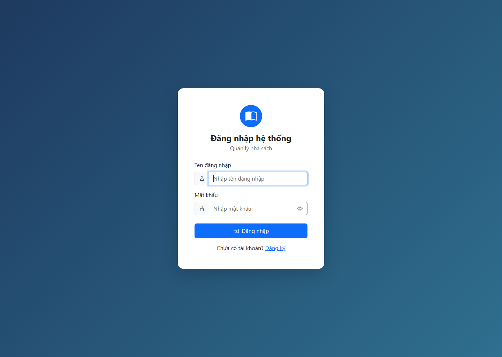

# Báo cáo Validation & Testing

Ngày kiểm thử: 28/10/2026  
Phạm vi: validation dữ liệu sách, CRUD sách, đăng nhập và phân quyền.

## Môi trường và an toàn dữ liệu

- CodeIgniter 4.7.5, PHPUnit 10.5.66, PHP XAMPP 8.2.12.
- Tất cả test có database dùng kết nối `tests` SQLite in-memory. Không migration, seed, đọc hoặc ghi vào MySQL `online_shop`.
- Khi chạy test CLI, các extension `intl`, `sqlite3`, `zip` chỉ được bật bằng tham số của tiến trình PHP.

## Kết quả

Lệnh đã chạy:

```powershell
C:\xampp\php\php.exe -d extension=intl -d extension=sqlite3 -d extension=zip vendor\bin\phpunit --no-coverage --testdox
```

Kết quả: **PASS – 33 tests, 220 assertions, exit code 0**.

`--no-coverage` chỉ tắt việc xuất báo cáo coverage vì máy chưa có Xdebug/PCOV; không tắt hay bỏ qua bất kỳ test nào.

## Test case

| ID | Nhóm | Kịch bản | Kết quả mong đợi | Kết quả |
| --- | --- | --- | --- | --- |
| VAL-01 | Dữ liệu sách | Tên/tác giả rỗng, chỉ khoảng trắng, sai kiểu, quá độ dài | Bị từ chối ở server | PASS |
| VAL-02 | Dữ liệu sách | Năm xuất bản lớn hơn năm Việt Nam hiện tại; kiểm tra lúc thêm và sửa | Bị từ chối, dữ liệu cũ không đổi | PASS |
| VAL-03 | Dữ liệu sách | Giá âm, quá giới hạn, 3 số lẻ; số lượng âm, lẻ hoặc tràn | Bị từ chối | PASS |
| VAL-04 | Dữ liệu sách | Giá/số lượng biên `0`, năm/NXB rỗng | Giá trị hợp lệ được lưu; trường tùy chọn rỗng thành `NULL` | PASS |
| CRUD-01 | Model | Thêm, đọc, sửa, xóa sách tiếng Việt | Có timestamp; sửa/xóa đúng bản ghi | PASS |
| CRUD-02 | HTTP route | Admin gọi `GET /books/create`, `POST /books/store`, `/update/{id}`, `/delete/{id}` với CSRF hợp lệ | Redirect đúng, bản ghi được tạo/sửa/xóa | PASS |
| CRUD-03 | HTTP route | Admin gửi dữ liệu sách không hợp lệ | Redirect về form, không có bản ghi nào được lưu | PASS |
| AUTH-01 | Đăng nhập | `POST /login` bằng tài khoản admin đã seed trong SQLite test | Redirect `/books`, session có `isLoggedIn`, `username`, `role=admin` | PASS |
| AUTH-02 | Xác thực | Khách truy cập `GET /books` | Redirect `/login` | PASS |
| AUTH-03 | Phân quyền | User thường xem danh sách và mở `/books/create` | Xem danh sách được; route quản trị redirect `/no-access` | PASS |
| AUTH-04 | Filter | Kiểm tra alias `auth`/`admin` và các nhánh guest, user, admin | Guest bị chặn; user bị chặn ở route admin; admin được cho phép | PASS |
| USER-01 | Tài khoản | Trùng username/email, mật khẩu không hợp lệ, tài khoản khóa | Validation/unique index/credential contract hoạt động | PASS |

Các test request mới nằm ở [`tests/feature/LibraryWorkflowFeatureTest.php`](../tests/feature/LibraryWorkflowFeatureTest.php). Chúng kiểm tra route, filter, CSRF, controller và database test cùng lúc; không chỉ gọi trực tiếp model/filter.

## Bằng chứng giao diện và runtime

- `GET http://127.0.0.1:8089/login` trả **HTTP 200**, `Content-Type: text/html; charset=UTF-8`; kiểm tra được form đăng nhập và input CSRF.
- Ảnh giao diện đã kiểm tra: [login-page-2026-10-28.png](evidence/login-page-2026-10-28.png).



Ảnh này xác nhận việc render trang đăng nhập ở desktop. Luồng submit bằng trình duyệt và CRUD trên MySQL thật không được khẳng định từ ảnh này; chúng được kiểm tra tự động với SQLite in-memory như mô tả ở trên.

## Lỗi gặp phải và cách xử lý

| Mã | Hiện tượng | Nguyên nhân xác định | Xử lý trong lần kiểm thử | Cách khắc phục lâu dài | Trạng thái |
| --- | --- | --- | --- | --- | --- |
| ENV-01 | `php spark serve` rồi mở `/login` trả HTTP 500: `Class "Locale" not found` | `C:\xampp\php\php.ini` đang tắt extension `intl` | Không sửa PHP toàn cục. Server kiểm thử được chạy bằng `php -d extension=intl -d extension=sqlite3 -d extension=zip -S 127.0.0.1:8089 -t public` và `/login` trả 200 | Bật `extension=intl` trong PHP dùng bởi Apache/CLI, sau đó khởi động lại dịch vụ | Đã có workaround; cấu hình máy vẫn cần được cập nhật nếu muốn dùng `spark serve` trực tiếp |
| ENV-02 | PHPUnit thông báo `No code coverage driver available` nếu dùng cấu hình coverage mặc định | Chưa cài Xdebug hoặc PCOV | Chạy `--no-coverage`; toàn bộ 33 test vẫn chạy và pass | Cài/enable Xdebug hoặc PCOV khi cần phần trăm coverage | Không chặn kiểm thử chức năng |
| TEST-01 | Feature test đăng nhập ban đầu lỗi do assertion session gọi trên test case | API assertion session của CI4 thuộc `TestResponse` | Đổi sang `$result->assertSessionHas(...)`, chạy lại full suite | Giữ mẫu assertion này khi thêm feature test | Đã sửa, full suite PASS |

## Giới hạn còn lại

- Chưa chạy CRUD bằng MySQL production/local thật để tránh đụng dữ liệu cấu hình sẵn; cần một database staging riêng nếu muốn test tích hợp MySQL.
- Chưa đo code coverage do thiếu coverage driver.
- Đã kiểm tra ảnh render trang login; chưa có kiểm thử tự động thao tác trình duyệt end-to-end với cookie/session thật. Các nhánh login và quyền đã có feature test HTTP cách ly.
